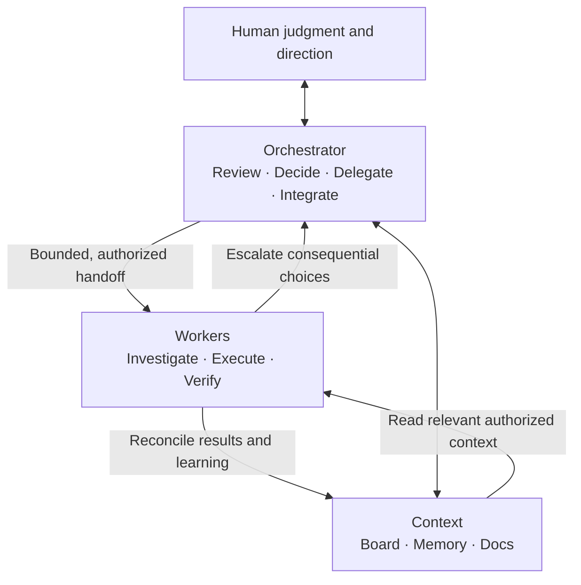
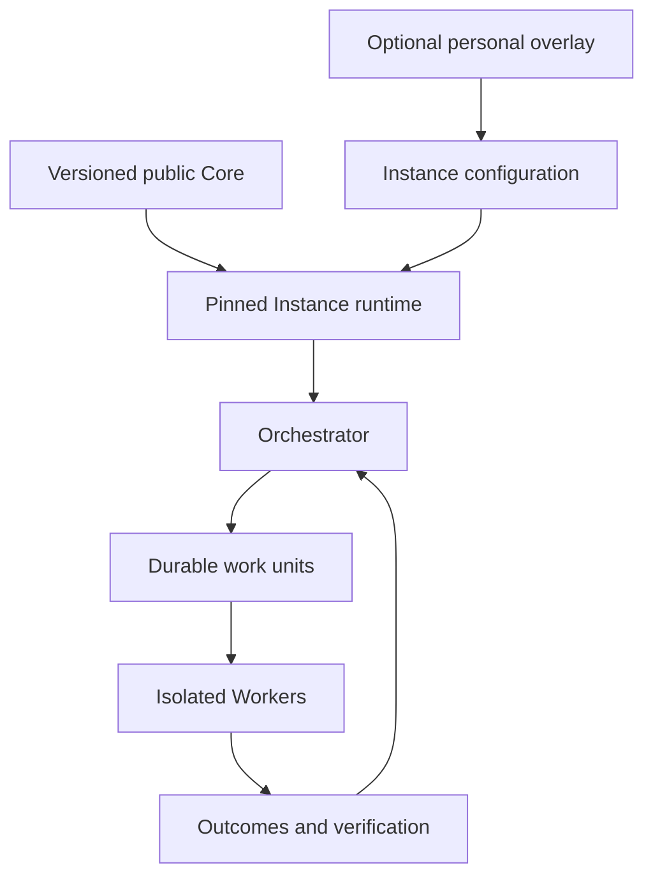

# Architecture

## Three-part operating model

Agent Hub coordinates work through **Orchestrator, Workers, and Context**.

| Part | Role | Boundary |
| --- | --- | --- |
| **Orchestrator** | Review the board with the human, clarify priorities and intent, delegate bounded work, and integrate outcomes. | Coordinates; does not micromanage Worker execution or make consequential decisions on the person's behalf. |
| **Workers** | Independently investigate, implement, verify, and report within delegated scope, using appropriate Instance skills (such as Equilio Coding where installed). | Own execution of the assigned work, not strategic direction or authorization beyond the handoff. |
| **Context** | Hold the authoritative information for direction, execution and continuity. | Context is referenced at its source; Agent Hub is not a parallel task board or knowledge database. |

Context has three complementary forms:

- **Board — what needs doing:** the canonical work source (for example Linear, GitHub Issues, Notion, or Markdown). It carries work status, intent, ownership, outcomes and verification according to the source's native schema.
- **Memory — what we have learned:** durable decisions, lessons, evidence and unresolved questions, stored in the existing work source or other authorized knowledge records. Not agent chat history or a mandatory new database.
- **Docs — what we know:** product, system and project conventions, repository instructions, specifications, and reference documentation.

These can live in the same system or different systems. Neither a particular provider nor automated authentication is required. A configured reference is not verified access.

**Working flow:**

1. **Review:** The human and Orchestrator examine the configured Board and relevant Context; exploration may end without creating work.
2. **Decide and delegate:** Agree on a useful outcome and scope. The Orchestrator prepares or references the canonical work artifact, passes relevant context and verification expectations, and delegates execution to a Worker.
3. **Execute:** The Worker uses appropriate skills and tools, updates the owning artifact as understanding changes, verifies results, and escalates consequential unresolved decisions. It operates independently rather than requiring constant Orchestrator supervision.
4. **Integrate:** The Orchestrator reads authoritative updates and evidence, assesses implications, and helps the human decide what happens next. Implementation, PR review, merge, release, and observed value remain distinct states.

This is an operating model, not a fixed software-development pipeline. Workers can investigate uncertainty or produce non-code artifacts; skills determine their own methods. No new handoff document or task registry is required if the owning source already provides continuity.

## Ownership and implementation

Core is a small CLI, not an owner of every resource. It uses Git, files, existing
agent runtimes and VS Code. An Instance's version history is independent of Core;
its overlay is independently owned and optional.

| Module | Responsibility |
| --- | --- |
| `config.py` | TOML layers, registry validation, local path resolution |
| `repos.py` | Identity checks, discovery, bootstrap, workspace, diagnostics, guards |
| `work.py` | Local execution recovery, worktree preparation, inspection and cleanup |
| `agents.py` | Small Codex launch adapter and filesystem sandbox probe |
| `evolution.py` | Initialization, pinned adoption, rollback, reconciliation, promotion |
| `security.py` | Heuristic credential and private-file scanning |

The Orchestrator supports Strategize → Coordinate → Integrate. Workers execute
bounded work. A Worker has an independently recoverable work unit; starting another
session does not create another task automatically.

Each work record has a UUID-based identity, intent, verification criteria, optional
source identity, scoped resource names, repository branch/base references, session
leases and brief operator evidence. It records local execution context without mirroring an
external provider's project state. No remote provider adapter is implemented yet.

Work metadata lives in `work/<id>/`. Generated execution directories live in
`.hub/worktrees/<id>/<repo>/`. Records are ignored execution metadata, not mirrored
source tickets. Requirements, outcomes and verification belong in the canonical
work source; create a local record only when execution needs it. Bounded
instructions, temporary outcomes, source snapshots, raw logs and checkouts stay
machine-local. Local file
locking serializes mutations on a machine; this is not distributed locking between
team members or machines. Coordinate branch ownership through your work source.

Core versions install into separate detached checkouts. The worktree for improving
Core belongs to a registered editable Core repository. The Orchestrator keeps using
its installed version while a Worker changes another checkout. Adoption is a
separate operator action. No self-modifying runtime or circular bootstrap is needed.

See ADR 001 for the version mechanism and `docs/security.md` for enforcement limits.
