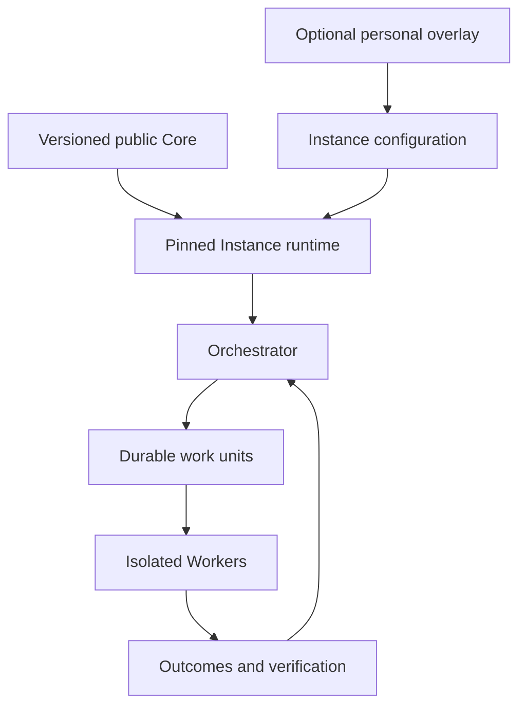

# Architecture

Core is a small CLI, not an owner of every resource. It uses Git, files, existing
agent runtimes and VS Code. An Instance's version history is independent of Core;
its overlay is independently owned and optional.

| Module | Responsibility |
| --- | --- |
| `config.py` | TOML layers, registry validation, local path resolution |
| `repos.py` | Identity checks, discovery, bootstrap, workspace, diagnostics, guards |
| `work.py` | Local execution recovery, worktree preparation, inspection and cleanup |
| `agents.py` | Small Codex launch adapter and filesystem sandbox probe |
| `evolution.py` | Initialization, pinned adoption, rollback, reconciliation, promotion |
| `security.py` | Heuristic credential and private-file scanning |

The Orchestrator supports Strategize → Coordinate → Integrate. Workers execute
bounded work. A Worker has an independently recoverable work unit; starting another
session does not create another task automatically.

Each work record has a UUID-based identity, intent, verification criteria, optional
source identity, scoped resource names, repository branch/base references, session
leases and brief operator evidence. It records local execution context without mirroring an
external provider's project state. No remote provider adapter is implemented yet.

Work metadata lives in `work/<id>/`. Generated execution directories live in
`.hub/worktrees/<id>/<repo>/`. Records are ignored execution metadata, not mirrored
source tickets. Requirements, outcomes and verification belong in the canonical
work source; create a local record only when execution needs it. Bounded
instructions, temporary outcomes, source snapshots, raw logs and checkouts stay
machine-local. Local file
locking serializes mutations on a machine; this is not distributed locking between
team members or machines. Coordinate branch ownership through your work source.

Core versions install into separate detached checkouts. The worktree for improving
Core belongs to a registered editable Core repository. The Orchestrator keeps using
its installed version while a Worker changes another checkout. Adoption is a
separate operator action. No self-modifying runtime or circular bootstrap is needed.

See ADR 001 for the version mechanism and `docs/security.md` for enforcement limits.
